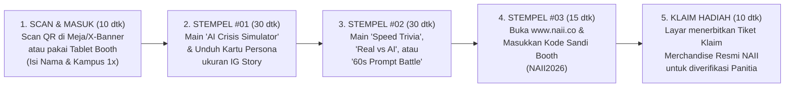

# Dokumen Konsep Permainan & Fitur Interaktif Booth NAII × CIFP 2026

**Acara:** 10th Conference on Indonesian Foreign Policy (CIFP 2026) — FPCI  
**Tema Konferensi:** *"Independent and Active Foreign Policy in the Next World Order"*  
**Tema Paviliun NAII:** *"Sovereign AI Talent & Digital Diplomacy — Belajar AI, Gratis di www.naii.co"*  
**Format Aplikasi:** Web Application Interaktif (Smartphone QR Scan, Tablet Kiosk Booth, & TV Live Leaderboard)

---

## 1. Ringkasan Eksekutif (*Executive Summary*)

Untuk memaksimalkan daya tarik pengunjung (*crowd puller*), edukasi literasi AI, dan konversi pendaftaran pengguna ke **`www.naii.co`** selama jeda sesi (*coffee break*) CIFP 2026 yang singkat, booth **Nusantara AI Institute (NAII)** menghadirkan platform web interaktif bertema **"Sovereign Diplomatic Terminal"**.

Pengunjung tidak perlu mengunduh aplikasi apa pun—cukup **Scan QR Code** melalui smartphone masing-masing atau bermain langsung di **Tablet Kiosk Booth** dalam durasi **60–90 detik**. Seluruh aktivitas permainan diikat oleh sistem **Paspor Stempel 3 Misi (*Diplomatic Mission Passport*)** yang menerbitkan **Tiket Klaim Merchandise Resmi NAII** di akhir misi.

---

## 2. Alur Pengunjung Booth (*Visitor Flow* — 60 hingga 90 Detik)

---

## 3. Empat Modul Permainan Utama (*The 4 Interactive Games*)

### Game 1: *Bebas-Aktif AI Crisis Simulator* (Aktivasi Utama & Kartu Persona IG Story)
* **Konsep:** Pengunjung berperan sebagai **Utusan Khusus Republik Indonesia** dalam menghadapi 3 skenario krisis geopolitik & teknologi dunia nyata:
  1. *Perang Dingin Semikonduktor & Blokade Chip AI (Indo-Pasifik)*
  2. *Deadlock Traktat Regulasi AI Global di Sidang Majelis Umum PBB*
  3. *Krisis Deepfake Lintas Batas & Kedaulatan Data Regional ASEAN (UU PDP)*
* **Cara Bermain (30–45 Detik):**
  1. Memilih 1 dari 3 skenario krisis.
  2. Memilih opsi sikap diplomasi RI (A / B / C) dan menambahkan *chip* kata kunci strategis satu-ketukan (*ASEAN, Global South, UU PDP, Non-Blok, Open-Source, Talenta Lokal, Etika AI, Kedaulatan*).
  3. Sistem mengevaluasi keputusan pada 3 dimensi (**Kemandirian/Bebas, Kepemimpinan Multilateral/Aktif, Literasi & Kedaulatan AI**) serta menampilkan respons dari 3 poros dunia (*Blok Barat, Tiongkok & Mitra Timur, Global South & ASEAN*).
* **Output & Viralitas Media Sosial:**
  * Menerbitkan **Kartu Persona Diplomat Digital** (*The Techno-Bridge Builder*, *The Sovereign Guardian*, atau *The Pragmatic Negotiator*).
  * Pengunjung dapat menekan tombol **"Unduh Kartu IG Story (PNG 1080×1920)"** atau **"Bagikan Kartu"** untuk langsung diunggah ke Instagram Story / LinkedIn dengan branding resmi NAII × CIFP 2026.
  * Otomatis membuka **Stempel Misi #01** pada Paspor peserta.

---

### Game 2: *Speed Trivia — Next World Order & AI* (Kompetisi Kecepatan Leaderboard)
* **Konsep:** Kuis adu cepat pilihan ganda untuk menguji wawasan seputar sejarah 10 tahun CIFP, doktrin Politik Luar Negeri Bebas-Aktif, Geopolitik AI, UU Pelindungan Data Pribadi (UU PDP), dan kurikulum gratis `www.naii.co`.
* **Cara Bermain (45–60 Detik):**
  * Sistem mengacak **5 pertanyaan** dari **15 bank soal resmi** (terbagi dalam 3 kategori).
  * Setiap soal memiliki batas waktu hitung mundur **12 detik**.
  * **Sistem Skor:** Jawaban benar bernilai `100 Poin Dasar` + `Bonus Kecepatan hingga 50 Poin` (maksimal **750 PTS**).
  * Otomatis membuka **Stempel Misi #02** dan mencatatkan nama peserta ke **Live Leaderboard** sesi break aktif.

---

### Game 3: *Real Diplomacy or AI Hallucination?* (Deteksi Fakta vs Halusinasi AI)
* **Konsep:** Permainan tebak cepat 2 tombol untuk mengedukasi pengunjung tentang bahaya *AI Hallucination* (kutipan traktat atau pasal palsu yang dikarang oleh AI generatif) dalam riset kebijakan luar negeri dan akademik.
* **Cara Bermain (30–45 Detik):**
  * Menampilkan **5 klaim diplomatik acak** dengan waktu **10 detik per klaim**.
  * Peserta menebak cepat menggunakan 2 tombol besar: **`[FAKTA DIPLOMASI ASLI]`** atau **`[HALUSINASI AI]`**.
  * Setiap jawaban langsung menampilkan penjelasan fakta arsip sejarah/hukum yang sebenarnya.
  * Skor maksimal **750 PTS**, tercatat di Live Leaderboard, dan membuka **Stempel Misi #02**.

---

### Game 4: *60-Second Diplomatic Prompt Battle* (Aktivasi Spesial Jam Coffee Break & Solo)
* **Konsep:** Menguji ketangkasan menyusun instruksi AI (*prompt engineering*) tingkat kebijakan luar negeri dalam waktu **60 detik** menggunakan **4 Pilar Metode NAII**:
  1. **Peran (*Role* — 25 Poin):** Menetapkan persona diplomatik (cth: *Analis Kebijakan Luar Negeri RI / Ketua Delegasi PBB*).
  2. **Konteks (*Context* — 25 Poin):** Memuat latar krisis geopolitik (cth: *kabel bawah laut Indo-Pasifik, traktat PBB, UU PDP*).
  3. **Batasan (*Constraint* — 25 Poin):** Menentukan batasan format & etika (cth: *1 paragraf, nada tegas netral, tidak memihak blok*).
  4. **Tujuan (*Objective* — 25 Poin):** Merumuskan solusi konkret (cth: *de-eskalasi, zona damai digital ASEAN, transfer teknologi*).
* **Dua Mode Permainan:**
  * **Mode 1 — *Solo Challenge* (Mandiri di HP/Tablet):** Peserta berlatih menyusun prompt dengan indikator radar 4 pilar yang menyala secara *real-time* saat mengetik. Skor dikonversi ke skala arena (**0–750 PTS**) dan masuk ke Live Leaderboard.
  * **Mode 2 — *1 vs 1 Stage Duel* (Aktivasi Panggung Dipandu MC):** Saat puncak keramaian *coffee break*, MC memanggil 2 delegasi untuk berduel ketik prompt di layar booth (Podium Merah vs Podium Emas). Sistem menampilkan perbandingan skor 4 pilar secara berdampingan, simulasi pidato yang dihasilkan AI dari prompt masing-masing pemain, dan mengumumkan pemenang secara otomatis.

---

## 4. Sistem Konversi & Hadiah: *Paspor Stempel 3 Misi & Tiket Klaim Merchandise*

Alih-alih membuat permainan terpisah yang membingungkan pengunjung, konsep *Booth Treasure Hunt* diintegrasikan langsung ke dalam **Paspor Stempel 3 Misi (*Diplomatic Mission Passport*)**:

| Urutan Stempel | Misi yang Harus Diselesaikan | Cara Terbuka |
| :--- | :--- | :--- |
| **Stempel #01** | **Kartu Persona Diplomat** | Otomatis tercap (`✓ STAMPED`) setelah menyelesaikan 1 skenario di *AI Crisis Simulator*. |
| **Stempel #02** | **Tantangan Arena Geopolitik × AI** | Otomatis tercap (`✓ STAMPED`) setelah menyelesaikan 1 ronde *Speed Trivia*, *Real vs AI*, atau *Prompt Battle*. |
| **Stempel #03** | **Eksplorasi `www.naii.co` & Kode Sandi Booth** | Peserta mengeklik tautan `www.naii.co` dan memasukkan **Kode Sandi Booth** (`NAII2026` / `CIFP2026` yang tertera di X-Banner/Meja Booth) + email opsional untuk akses kursus gratis. |

### Tiket Klaim Merchandise Resmi NAII & Verifikasi Anti-Kecurangan
Begitu **3/3 Stempel** terkumpul, bagian bawah paspor otomatis menerbitkan **Tiket Klaim Merchandise Resmi NAII** bergaya *Diplomatic Boarding Pass*:
1. **Kode Voucher Unik:** Setiap perangkat memiliki kode tiket unik (contoh: `NAII-26-8F4K`) beserta rekap nama delegasi, asal kampus/instansi, gelar Persona, dan skor permainan.
2. **Tombol Konfirmasi Khusus Panitia Meja Booth:**
   * Pengunjung menunjukkan layar tiket aktif (`AKTIF · TUNJUKKAN KE PANITIA BOOTH`) kepada petugas meja booth.
   * Petugas menekan tombol **`Verifikasi Panitia Meja Booth`** $\rightarrow$ **`Ya, Tandai Sudah Diserahkan`**.
   * Status tiket berubah permanen menjadi **`SUDAH DIKLAIM DI BOOTH`** sehingga 1 perangkat/HP tidak dapat digunakan untuk mengantre klaim merchandise berulang kali.

### Skema Tingkatan Hadiah (*Reward Tiering*)
* **Tier 1 (Minimal 1 Stempel):** Stiker Eksklusif *"AI-Ready Diplomat — NAII × CIFP 2026"*.
* **Tier 2 (3/3 Stempel Lengkap + Buka `www.naii.co`):** Paket Merchandise Resmi NAII (*Totebag / Notebook / Lanyard / Pin*) + Kartu Persona Digital HD.
* **Tier 3 (Top 3 Leaderboard per Sesi Break & Juara Duel 1v1):** *Grand Merchandise* Resmi NAII yang diumumkan setiap akhir sesi *Break Pagi*, *Break Siang*, dan *Break Sore*.

---

## 5. Fitur Pendukung Operasional Event (*Event-Grade Features*)

1. **Live Leaderboard dengan Mode Layar TV Fullscreen:**
   * Menampilkan Podium Juara #1, #2, #3 dan tabel peringkat delegasi secara *real-time* (menggunakan Supabase Realtime — begitu pengunjung selesai main di HP, skor langsung muncul di TV booth dengan efek *highlight*).
   * Dilengkapi filter instrumen permainan (*Semua, Speed Trivia, Real vs AI, Prompt Battle*) dan filter sesi (*Break Pagi, Break Siang, Break Sore*).
   * Memiliki tombol **"Simulasi Skor TV Booth"** untuk pengisian tampilan awal sebelum pintu hall dibuka.
2. **Dwibahasa Penuh (*Bilingual ID / EN Instant Switch*):**
   * Seluruh antarmuka, 3 skenario krisis, 15 soal trivia, 10 klaim fakta vs AI, 3 misi prompt battle, hingga gambar PNG Kartu Persona yang diunduh mendukung **Bahasa Indonesia (ID)** dan **Bahasa Inggris (EN)** secara instan untuk melayani delegasi lokal maupun diplomat/tamu internasional.
3. **Stasiun Mini Live Demo AI (2 Unit Laptop/Tablet) — *Co-Pilot Kebijakan & Simulasi Wawancara Karier*:**
   * Tersedia langsung di bagian **AI Diplomatic Co-Pilot & Mini Live Demo Workbench** pada halaman Beranda untuk didemokan oleh tim penjaga booth dalam 60 detik (maupun dicoba mandiri oleh pengunjung tanpa tekanan timer):
     * **Tab 01 — Menyusun Policy Brief:** Perbandingan prompt biasa vs prompt metode NAII untuk merancang rekomendasi sikap delegasi RI.
     * **Tab 02 — Deteksi Bias Media Global:** Membedah perbedaan *framing* media Barat vs Global South terhadap Sentralitas ASEAN.
     * **Tab 03 — Draf Intervensi / Pidato Pleno:** Merancang naskah pidato forum internasional berdurasi presisi 2 menit.
     * **Tab 04 — Simulasi Wawancara Kerja & Karier Diplomat (*AI Career & Scholarship Mock Interview*):** Simulasi latihan wawancara seleksi Calon Diplomat Kemlu, organisasi internasional (ASEAN/PBB), dan beasiswa luar negeri (LPDP/Chevening/Fulbright) dengan evaluasi metode **STAR (*Situation, Task, Action, Result*)**.
     * **Mode Sandbox Ketik Langsung (Tanpa Timer):** Dilengkapi fitur *"Coba Demo Ketik Prompt Langsung"* di mana tim booth atau pengunjung dapat mengubah kalimat prompt, melihat **Meteran 4 Pilar NAII (*Peran, Konteks, Batasan, Tujuan*)** menyala secara *real-time*, dan melihat pratinjau respons AI secara instan.
4. **Sistem Dual QR Code Akses Instan (*Zero-Typing Smartphone Access*, 100% Offline SVG):**
   * Pengunjung tidak perlu mengetik alamat web di browser HP. Aplikasi menyediakan generator **QR Code Vektor SVG ISO/IEC 18004** bawaan yang tampil tajam di:
     * **QR 01 (`https://naii-cifp2026-game.vercel.app/`):** Dilengkapi pemilih *Deep-Link* langsung ke *Beranda*, *Simulator*, *Speed Trivia*, atau *Prompt Battle*.
     * **QR 02 (`https://www.naii.co`):** Akses langsung ke 20+ kursus AI gratis & penyelesaian Stempel Misi #03.
   * Tersedia langsung di halaman **Beranda**, **Layar TV Live Leaderboard** (untuk di-scan dari jauh), **Tombol `QR` di Header Atas**, dan di dalam **Modal Paspor Stempel #03**.
5. **Arsitektur Hybrid Offline-First (Tahan Sinyal Padat):**
   * Jika koneksi internet di The Kasablanka Hall sempat melambat akibat ribuan pengunjung, aplikasi tetap berjalan lancar menggunakan penyimpanan lokal dan otomatis melakukan sinkronisasi antrean skor ke database cloud saat sinyal kembali stabil.
6. **Auto-Reset Kiosk Tablet Booth (3 Menit Idle):**
   * Pada tablet yang disediakan di meja booth, jika tidak ada sentuhan selama 3 menit, aplikasi otomatis mereset profil pemain dan kembali ke halaman utama agar siap dipakai pengunjung berikutnya (tidak berlaku pada layar TV Leaderboard).
7. **Kepatuhan Privasi Data (UU PDP No. 27/2022):**
   * Input email bersifat sukarela dengan persetujuan eksplisit, dan diamankan dengan kebijakan *Row Level Security (RLS) Insert-Only* di database sehingga daftar kontak pengunjung tidak dapat diakses oleh publik.

---

## 6. Checklist Kebutuhan Perangkat & SOP Panitia di Lokasi

### Kebutuhan di Booth NAII:
- [ ] **1 Unit TV / Monitor Besar:** Membuka halaman `#/leaderboard` dalam mode **Fullscreen** (tampilan *Dark Mode*).
- [ ] **2 Unit Laptop / Tablet di Meja Booth (*Mini Live Demo AI Station*):** Membuka halaman utama aplikasi (bagian *Mini Live Demo AI Workbench* & permainan interaktif) berdampingan dengan tab `www.naii.co` untuk didemokan langsung oleh tim penjaga booth dalam 60 detik.
- [ ] **Stand Akrilik QR Code di Meja Depan & X-Banner:**
  - Mengarah ke URL aplikasi web yang telah di-deploy di Vercel.
  - Mencantumkan **Kode Sandi Booth: `NAII2026`** pada X-Banner atau meja registrasi agar pengunjung dapat menyelesaikan Stempel #03.

### SOP 10 Detik Panitia Meja Merchandise:
1. Pengunjung menunjukkan layar **Tiket Klaim Merchandise Resmi NAII (`3/3 Stempel Lengkap`)** di HP mereka.
2. Panitia memastikan status di kanan atas tiket masih bertuliskan **`AKTIF · TUNJUKKAN KE PANITIA BOOTH`**.
3. Panitia menekan tombol **`Verifikasi Panitia Meja Booth`** $\rightarrow$ **`Ya, Tandai Sudah Diserahkan`** di layar HP pengunjung, lalu menyerahkan merchandise.
