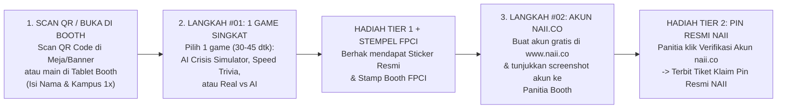

# Dokumen Konsep Permainan & Fitur Interaktif Booth NAII × CIFP 2026

**Acara:** 10th Conference on Indonesian Foreign Policy (CIFP 2026) — FPCI  
**Tema Konferensi:** *"Independent and Active Foreign Policy in the Next World Order"*  
**Tema Paviliun NAII:** *"Sovereign AI Talent & Digital Diplomacy — Belajar AI, Gratis di www.naii.co"*  
**Format Aplikasi:** Web Application Interaktif (Smartphone QR Scan, Tablet Kiosk Booth, & TV Live Leaderboard)  
**Biaya API AI:** **`Rp 0`** (100% *pre-written* & *rule-based engine* lokal, tanpa ketergantungan API LLM eksternal)

---

## 1. Ringkasan Eksekutif (*Executive Summary*)

Untuk memaksimalkan daya tarik pengunjung (*crowd puller*), edukasi literasi AI, dan konversi pendaftaran akun ke **`www.naii.co`** selama jeda sesi (*coffee break*) CIFP 2026 yang singkat, booth **Nusantara AI Institute (NAII)** menghadirkan platform web interaktif bertema **"Sovereign Diplomatic Terminal"**.

Pengunjung tidak perlu mengunduh aplikasi apa pun—cukup **Scan QR Code** melalui smartphone masing-masing atau bermain langsung di **Tablet Kiosk Booth** dalam durasi **30–60 detik**. Seluruh aktivitas booth diikat oleh sistem **Paspor 2 Langkah (*Diplomatic Mission Passport*)** yang ringkas dan ramah antrean (*zero friction*).

---

## 2. Alur Pengunjung Booth (*Visitor Flow* — 2 Langkah Cepat)

---

## 3. Tiga Modul Permainan Inti (*Core Interactive Games*)

Fokus utama navigasi dan beranda booth dialokasikan pada **3 permainan singkat** yang paling efektif mendorong keterlibatan pengunjung (*Speed Trivia*, *Real vs AI*, dan *AI Crisis Simulator*), tanpa mode duel panggung 1v1 (MC):

### Game 1: *Bebas-Aktif AI Crisis Simulator* (Aktivasi Diplomasi & Kartu Persona IG Story)
* **Konsep:** Pengunjung berperan sebagai **Utusan Khusus Republik Indonesia** dalam menghadapi 3 skenario krisis geopolitik & teknologi dengan *framing* netral:
  1. *Kompetisi Semikonduktor & Akses Teknologi AI*
  2. *Kedaulatan Data & Tata Kelola AI ASEAN (UU PDP)*
  3. *Krisis Disinformasi Deepfake di Indo-Pasifik*
* **Cara Bermain (30–45 Detik):**
  1. Memilih 1 dari 3 skenario krisis.
  2. Memilih opsi sikap diplomasi RI (A / B / C) dan menambahkan *chip* kata kunci strategis satu-ketukan (*ASEAN, Global South, UU PDP, Non-Blok, Open-Source, Talenta Lokal, Etika AI, Kedaulatan*).
  3. Sistem mengevaluasi keputusan pada 3 dimensi (**Kemandirian/Bebas, Kepemimpinan Multilateral/Aktif, Literasi & Kedaulatan AI**) serta menampilkan respons berimbang dari **Mitra Barat**, **Poros Mitra Timur**, dan **Global South & ASEAN** tanpa menyebutkan negara tertentu secara sensitif.
* **Output & Viralitas Media Sosial:**
  * Menerbitkan **Kartu Persona Diplomat Digital** (*The Techno-Bridge Builder*, *The Sovereign Guardian*, atau *The Pragmatic Negotiator*).
  * Pengunjung dapat menekan tombol **"Unduh Kartu IG Story (PNG 1080×1920)"** atau **"Bagikan Kartu"** untuk diunggah ke Instagram Story / LinkedIn dengan branding NAII × CIFP 2026.
  * Otomatis membuka **Stempel #01 (Main 1 Game Singkat)** pada Paspor peserta.

---

### Game 2: *Speed Trivia — Next World Order & AI* (Kompetisi Kecepatan Leaderboard)
* **Konsep:** Kuis adu cepat pilihan ganda untuk menguji wawasan seputar sejarah 10 tahun CIFP, doktrin Politik Luar Negeri Bebas-Aktif, Geopolitik AI, **UU No. 27 Tahun 2022 tentang Pelindungan Data Pribadi (UU PDP)**, dan kurikulum gratis `www.naii.co`.
* **Cara Bermain (45–60 Detik):**
  * Sistem mengacak **5 pertanyaan** dari **15 bank soal** (terbagi dalam 3 kategori).
  * Setiap soal memiliki batas waktu hitung mundur **12 detik**.
  * **Sistem Skor:** Jawaban benar bernilai `100 Poin Dasar` + `Bonus Kecepatan hingga 50 Poin` (maksimal **750 PTS**).
  * Otomatis membuka **Stempel #01** dan mencatatkan nama peserta ke **Live Leaderboard** sesi break aktif.

---

### Game 3: *Real Diplomacy or AI Hallucination?* (Deteksi Fakta vs Halusinasi AI)
* **Konsep:** Permainan tebak cepat 2 tombol untuk mengedukasi pengunjung tentang bahaya *AI Hallucination* (kutipan traktat atau pasal palsu yang dikarang oleh AI generatif) dalam riset kebijakan luar negeri dan akademik.
* **Cara Bermain (30–45 Detik):**
  * Menampilkan **5 klaim diplomatik acak** dari **12 bank klaim** dengan waktu **10 detik per klaim**.
  * Peserta menebak cepat menggunakan 2 tombol besar: **`[FAKTA DIPLOMASI ASLI]`** atau **`[HALUSINASI AI]`**.
  * Setiap jawaban langsung menampilkan penjelasan fakta arsip sejarah/hukum yang sebenarnya.
  * Skor maksimal **750 PTS**, tercatat di Live Leaderboard, dan membuka **Stempel #01**.

---

## 4. Sistem Paspor 2 Langkah & Skema Hadiah (*Budget-Aligned Rewards*)

Konsep *Booth Engagement & Passport* disederhanakan menjadi **2 Langkah Tanpa Kode Sandi** (tanpa perlu mengetik kode booth `NAII2026` maupun memutar *Spin Wheel*):

| Langkah | Syarat Penyelesaian | Hadiah & Output Sistem |
| :--- | :--- | :--- |
| **Langkah #01 — Main 1 Game Singkat** | Otomatis tercap (`✓ STAMPED`) setelah menyelesaikan **1 game** apa saja (*Speed Trivia*, *Real vs AI*, atau *AI Crisis Simulator*). | Berhak mendapat **Sticker Resmi NAII × CIFP 2026 + Stamp Booth FPCI** (*Tier 1*). |
| **Langkah #02 — Verifikasi Akun `www.naii.co`** | Pengunjung membuat akun gratis di **`www.naii.co`**, lalu menunjukkan **bukti screenshot akun** kepada Panitia Meja Booth. | Panitia menekan tombol **`Verifikasi Akun naii.co (Panitia)`** $\rightarrow$ **`Konfirmasi Akun Valid`** untuk membuka Tiket Klaim **Pin Resmi NAII** (*Tier 2*). |

### Skema Tingkatan Hadiah (*Reward Tiering* Sesuai Anggaran Booth)
* **Tier 1 (Selesai 1 Game Singkat):** **Sticker Eksklusif NAII × CIFP 2026 + Stamp Paspor FPCI**.
* **Tier 2 (Buat Akun `www.naii.co` + Tunjukkan Screenshot ke Panitia):** **Pin Resmi NAII**.
* **Tier 3 (Top 3 Leaderboard per Sesi Break — Pagi, Siang, Sore):** **Totebag Resmi NAII** bagi 3 delegasi dengan skor tertinggi pada setiap sesi break.
* **VIP Reward (Kontak Utama / Tamu VIP):** **Kalender Meja / Dinding VIP NAII**.

### Verifikasi Anti-Kecurangan oleh Panitia Meja Booth
Begitu Langkah #01 & #02 terverifikasi (`2/2 LANGKAH LENGKAP`), bagian bawah Paspor menerbitkan **Tiket Klaim Pin Resmi NAII (Tier 2)** bergaya *Diplomatic Boarding Pass*:
1. **Kode Tiket Unik:** Setiap perangkat memiliki kode tiket unik (contoh: `NAII-26-8F4K`) beserta nama delegasi, asal kampus/instansi, dan email akun `naii.co` (opsional).
2. **Konfirmasi 2-Tahap Panitia:**
   * Jika baru Langkah #01 selesai, pengunjung dapat langsung menerima **Tier 1 (Sticker + Stamp FPCI)** dan melihat panduan membuat akun `www.naii.co`.
   * Setelah melihat screenshot akun `www.naii.co`, panitia menekan **`Verifikasi Akun naii.co (Panitia)`** $\rightarrow$ **`Konfirmasi Akun Valid`** pada kartu Langkah #02. Tiket Klaim aktif dengan status **`AKTIF · TUNJUKKAN KE PANITIA BOOTH`**.
   * Saat menyerahkan **Pin Resmi NAII (Tier 2)**, panitia menekan **`Verifikasi Panitia Meja Booth`** $\rightarrow$ **`Ya, Pin Sudah Diserahkan`** pada bagian tiket, sehingga status berubah permanen menjadi **`SUDAH DIKLAIM DI BOOTH`** (`Telah Diverifikasi Panitia`).

---

## 5. Fitur Pendukung Operasional Event (*Event-Grade Features*)

1. **Live Leaderboard dengan Mode Layar TV Fullscreen:**
   * Menampilkan Podium Juara #1, #2, #3 dan tabel peringkat delegasi secara *real-time* (menggunakan Supabase Realtime — begitu pengunjung selesai main *Speed Trivia* atau *Real vs AI* di HP, skor langsung muncul di TV booth dengan efek *highlight*).
   * Dilengkapi filter instrumen (**Semua**, **Speed Trivia**, **Real vs AI**) dan filter sesi sesuai rundown resmi CIFP 2026 (**Break Pagi 11:25–12:00**, **Break Siang 13:15–14:00**, **Break Sore 15:15–16:00 WIB**).
   * Memiliki tombol **"Muat Simulasi Skor TV Booth"** untuk pengisian tampilan awal sebelum pintu hall dibuka.
2. **Dwibahasa Penuh (*Bilingual ID / EN Instant Switch*):**
   * Seluruh antarmuka, 3 skenario krisis, 15 soal trivia, 12 klaim fakta vs AI, hingga gambar PNG Kartu Persona yang diunduh mendukung **Bahasa Indonesia (ID)** dan **Bahasa Inggris (EN)** secara instan.
3. **Stasiun Mini Live Demo AI (*Co-Pilot Kebijakan & Diplomasi*) — 3 Tab:**
   * Tersedia di halaman Beranda untuk didemokan oleh tim penjaga booth dalam 60 detik maupun dicoba mandiri oleh pengunjung (tab simulasi wawancara karier ditiadakan agar fokus pada materi diplomasi & literasi AI):
     * **Tab 01 — Menyusun Policy Brief:** Perbandingan prompt biasa vs prompt metode NAII untuk merancang rekomendasi sikap delegasi RI.
     * **Tab 02 — Audit Framing Media Global:** Membedah perbedaan *framing* media mitra maju vs Global South secara netral dan menjaga sentralitas ASEAN.
     * **Tab 03 — Draf Intervensi / Pidato Pleno:** Merancang naskah pidato forum internasional berdurasi presisi 2 menit.
     * **Mode Sandbox Ketik Langsung (Tanpa Timer):** Dilengkapi *Meteran 4 Pilar NAII (Peran, Konteks, Batasan, Tujuan)* berbasis aturan lokal (`Rp 0` biaya API AI).
4. **Sistem Dual QR Code Akses Instan (*Zero-Typing Smartphone Access*, 100% Offline SVG):**
   * Pengunjung tidak perlu mengetik alamat web di browser HP. Aplikasi menyediakan generator **QR Code Vektor SVG ISO/IEC 18004** bawaan yang tampil tajam di:
     * **QR 01 (`https://naii-cifp2026-game.vercel.app/`):** Dilengkapi pemilih *Deep-Link* langsung ke **Beranda**, **Speed Trivia**, **Real vs AI**, atau **Crisis Simulator**.
     * **QR 02 (`https://www.naii.co`):** Akses langsung pendaftaran akun gratis untuk menyelesaikan **Langkah #02 (Pin Resmi NAII)**.
   * Tersedia langsung di halaman **Beranda**, **Layar TV Live Leaderboard**, **Tombol `QR` di Header Atas**, dan di dalam **Modal Paspor Langkah #02**.
5. **Arsitektur Hybrid Offline-First & Auto-Reset Kiosk (3 Menit Idle):**
   * Jika koneksi internet di The Kasablanka Hall melambat, aplikasi tetap berjalan menggunakan penyimpanan lokal (`localStorage`) dan menyinkronkan skor ke Supabase saat sinyal stabil.
   * Pada tablet booth, jika idle 3 menit, aplikasi otomatis mereset profil pemain dan kembali ke halaman utama (tidak berlaku pada layar TV Leaderboard).
6. **Kepatuhan Privasi Data (UU No. 27 Tahun 2022 tentang Pelindungan Data Pribadi / UU PDP):**
   * Input email dan checkbox persetujuan eksplisit sesuai UU No. 27 Tahun 2022 tentang Pelindungan Data Pribadi (UU PDP) wajib diisi saat registrasi awal, dan diamankan dengan kebijakan *Row Level Security (RLS) Insert-Only* di Supabase sehingga email bersifat privat.

---

## 6. Checklist Operasional, Fact-Check, & Handover Akses NAII

### A. Kebutuhan di Booth NAII:
- [ ] **1 Unit TV / Monitor Besar:** Membuka halaman `#/leaderboard` dalam mode **Fullscreen** (*Dark Mode*).
- [ ] **1–2 Unit Laptop / Tablet di Meja Booth:** Membuka halaman utama aplikasi & halaman `www.naii.co` untuk demo singkat 60 detik atau cadangan bermain pengunjung.
- [ ] **Stand Akrilik / Print Dual QR Code:** Menampilkan QR Game (`https://naii-cifp2026-game.vercel.app/`) dan QR Daftar Akun (`https://www.naii.co`) **tanpa kode sandi**.
- [ ] **Logistik Hadiah & Stempel:** Sticker + Stempel FPCI (Tier 1), Pin Resmi NAII (Tier 2), Totebag Resmi NAII untuk Top 3 per break (Tier 3), serta Kalender VIP.

### B. Checklist Fact-Check Materi Kuis *(Assign 1 PIC Review Sebelum Hari-H)*:
- [ ] Verifikasi 15 soal & kunci jawaban **Speed Trivia** ([src/data/trivia.ts](src/data/trivia.ts)): tema CIFP ke-10 2026, pidato Hatta 1948, Global South/Bandung 1955, FPCI/Dr. Dino Patti Djalal, *ASEAN Guide on AI Governance and Ethics* (2024), **UU No. 27 Tahun 2022 tentang Pelindungan Data Pribadi (UU PDP)**, dan 3 *curriculum tracks* + durasi kursus `www.naii.co`.
- [ ] Verifikasi 12 klaim **Real vs AI** ([src/data/realVsAi.ts](src/data/realVsAi.ts)): Konvensi Wina 1969, UU PDP No. 27/2022, KTT GNB perdana Beograd 1961, Deklarasi Bangkok 8 Agustus 1967, Pidato Hatta di BP KNIP Yogyakarta 2 September 1948, EU AI Act 2024, Keketuaan ASEAN Indonesia 2023 (*ASEAN Matters: Epicentrum of Growth*), komposisi 5 anggota tetap DK PBB, Dasasila Bandung 1955, serta klaim program gratis `www.naii.co`.

### C. Checklist Handover Akses & Infrastruktur ke Tim NAII *(Sebelum Event)*:
- [ ] **Akses Repository & Vercel:** Undang akun GitHub/Vercel resmi NAII sebagai collaborator/owner project `naii-cifp2026-game`, atau transfer kepemilikan deployment produksi (`https://naii-cifp2026-game.vercel.app/`).
- [ ] **Akses Database Supabase:** Berikan akses dashboard project Supabase (*Organization/Member Invite*) kepada PIC teknis NAII, sertakan dokumentasi skema tabel di [supabase-schema.sql](supabase-schema.sql) (`leaderboard`, `diplomat_personas`, dan `leads` yang bersifat *insert-only* untuk publik), serta panduan ekspor data CSV pendaftar melalui Supabase Dashboard / `service_role` pasca-acara.
- [ ] **Environment Variables & Backup:** Pastikan salinan `VITE_SUPABASE_URL` dan `VITE_SUPABASE_ANON_KEY` terdokumentasi dengan aman pada kredensial serah-terima tim NAII.

### D. SOP 10 Detik Panitia Meja Booth:
1. Pengunjung menyelesaikan **1 game singkat** di HP/Tablet $\rightarrow$ Panitia melihat **`TERCAP ✓`** pada Langkah #01 di Paspor dan memberikan **Sticker + Stamp Booth FPCI (Tier 1)**.
2. Panitia mengajak pengunjung scan QR `www.naii.co` di modal Paspor untuk membuat akun gratis dan menunjukkan **bukti screenshot akun yang sudah dibuat**.
3. Setelah screenshot dicek, panitia menekan **`Verifikasi Akun naii.co (Panitia)`** $\rightarrow$ **`Konfirmasi Akun Valid`** untuk menerbitkan Tiket Klaim berstatus **`AKTIF · TUNJUKKAN KE PANITIA BOOTH`**, lalu menyerahkan **Pin Resmi NAII (Tier 2)** dan menekan **`Verifikasi Panitia Meja Booth`** $\rightarrow$ **`Ya, Pin Sudah Diserahkan`** (`SUDAH DIKLAIM DI BOOTH`).
4. Setiap akhir sesi *Break Pagi*, *Break Siang*, dan *Break Sore*, panitia mengumumkan Top 3 dari TV Live Leaderboard untuk penyerahan **Totebag Resmi NAII (Tier 3)**.
